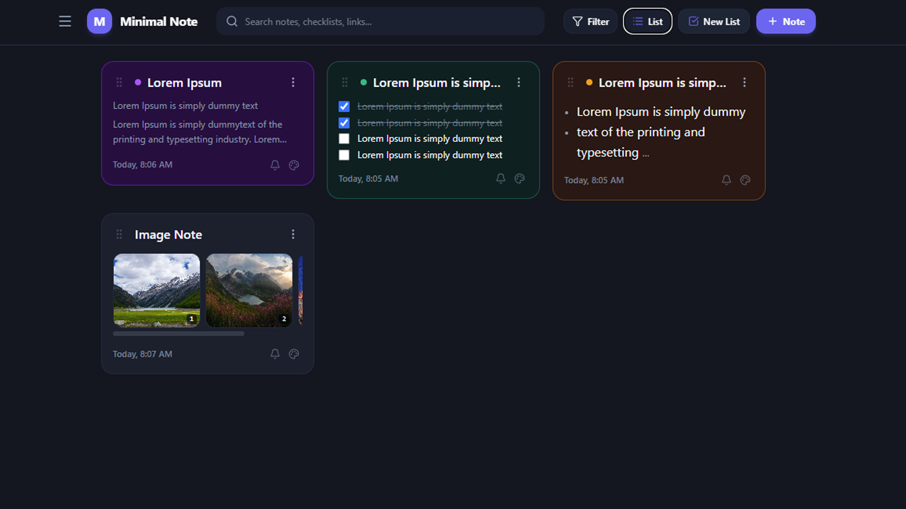
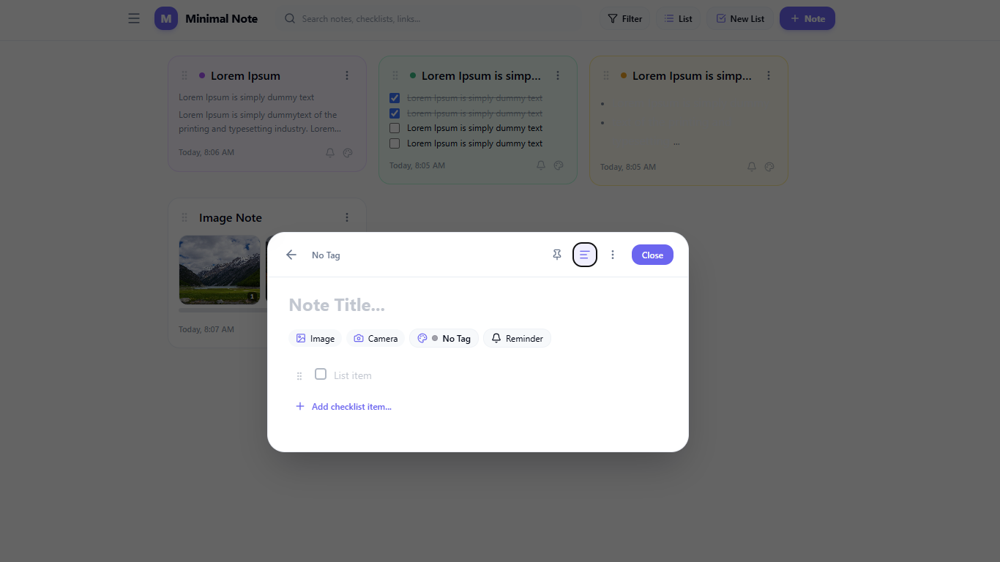

<div align="center">

  

  # Minimal Note

  **Distraction-free, offline-first personal notes & checklist PWA with in-browser OCR, smart reminders, and 16 global languages.**

  <p align="center">
    <a href="https://note.yink.in/"><strong>🚀 Open Live Web App</strong></a> •
    <a href="https://github.com/glofora/minimal-note/stargazers"><strong>⭐ Star on GitHub</strong></a> •
    <a href="https://github.com/glofora/minimal-note/issues"><strong>🐛 Report Issue</strong></a>
  </p>

  <p align="center">
    <a href="https://note.yink.in/"></a>
    <a href="https://note.yink.in/"></a>
    <a href="https://github.com/glofora/minimal-note"></a>
    <a href="https://note.yink.in/"></a>
    <a href="https://github.com/glofora/minimal-note/stargazers"></a>
    <a href="LICENSE"></a>
  </p>

</div>

---

> [!TIP]
> ### 📲 Instant App on Any Device — No App Store Needed!
> **Minimal Note runs natively across iOS, Android, macOS, Windows, and Linux.**
> Just open **[note.yink.in](https://note.yink.in/)** in your device's default browser and install the Progressive Web App (PWA) in seconds:
>
> | Platform | Browser | Fast 1-Step Installation |
> | :--- | :--- | :--- |
> | 🍏 **iOS (iPhone & iPad)** | Safari | Tap **Share** (📤) ➔ Select **"Add to Home Screen"** (⊞) |
> | 🤖 **Android** | Chrome / Samsung Internet / Edge | Tap **"Install App"** prompt on launch or browser menu (⋮) |
> | 💻 **macOS & Windows** | Chrome / Edge / Brave / Opera | Click the **Install App (⊕)** icon in the address bar or app banner |
> | 🐧 **Linux** | Chrome / Chromium / Edge | Click **"Install App"** in the top bar or browser menu |
>
> *Once installed, Minimal Note launches with a zero-latency animated splash screen, full-screen standalone window without address bar, and works **100% offline** with private on-device storage.*

---

## 📸 App Showcase

<div align="center">

### Desktop Workspace


<br/><br/>

| 📱 Mobile View &amp; Navigation | ✍️ Note &amp; Checklist Editor |
| :---: | :---: |
|  |  |

</div>

---

## ✨ Key Features

- **📝 Interactive Checklists & Structured Lists**
  - Instant checkbox toggle with smooth strike-through animation.
  - Automatic grouping of finished tasks into a collapsible completed section.
  - Fluid keyboard workflow: press `Enter` to create the next item, `Backspace` on an empty item to delete.
  - Seamlessly toggle any note between freeform markdown text and interactive checklist mode.

- **📷 Multiple Image Attachments & Canvas Scaling**
  - Attach multiple photos from file upload or camera capture.
  - Client-side canvas compression downscaling (max 640px) to conserve browser memory and IndexedDB storage.
  - Grid preview with individual image deletion and OCR extraction.

- **🔍 In-Browser OCR (Optical Character Recognition)**
  - Client-side text extraction using WebAssembly (`tesseract.js`).
  - Extract text directly from receipts, book pages, and whiteboard pictures into your note without sending data to third-party servers.

- **🌐 16 Global Languages (i18n)**
  - Comprehensive internationalization system: **English, Español, Français, Deutsch, Italiano, Português, Русский, Türkçe, العربية, हिन्दी, বাংলা, தமிழ், Bahasa Indonesia, 日本語, 한국어, and 简体中文**.
  - Searchable language modal accessible from the web header and mobile side drawer.
  - Real-time reactive updates of all UI keywords, placeholders, and buttons.

- **⏰ Smart Scheduled Reminders**
  - Set custom date & time alerts with 12-hour or 24-hour clock formats.
  - Quick presets: *In 1 hour*, *In 3 hours*, or *Tomorrow morning*.
  - Built-in snooze controls (10, 30, and 60 minutes) when reminders trigger.

- **⚡ Progressive Web App (PWA) & Instant Splash**
  - Zero-latency animated splash screen prevents blank screens during initial hydration.
  - Works **100% offline** via Service Worker caching (`public/sw.js`).
  - Automatic prompt to install on launch for mobile home screens and desktop apps.
  - Step-by-step guidance for iOS Safari "Add to Home Screen".

- **🎨 Gestures & Color Organization**
  - Drag-and-drop manual reordering of notes using `@dnd-kit`.
  - Swipe-to-delete gesture with an instant Undo snackbar.
  - 9 refined color tags with coordinated dark and light theme styles.
  - Dark mode, light mode, and system preference detection.

- **🔒 Local Storage Privacy & Data Portability**
  - All notes, images, and preferences reside locally on your device via `Dexie.js` (IndexedDB).
  - No trackers, telemetry, or mandatory cloud logins.
  - One-click backup export and restore via structured JSON files.

---

## 🛠️ Technology Stack

| Layer | Technology |
| :--- | :--- |
| **Framework & Language** | [React 19](https://react.dev/), [TypeScript](https://www.typescriptlang.org/), [Vite 6](https://vitejs.dev/) |
| **Styling & Layout** | [Tailwind CSS](https://tailwindcss.com/), Mobile-first Responsive Design |
| **State Management** | [Zustand](https://zustand-demo.pmnd.rs/) |
| **Local Database** | [Dexie.js](https://dexie.org/) (IndexedDB wrapper) |
| **Motion & Drag-and-Drop** | [Framer Motion](https://www.framer.com/motion/), [@dnd-kit](https://dndkit.com/) |
| **In-Browser OCR** | [Tesseract.js](https://tesseract.projectnaptha.com/) (WebAssembly) |
| **Icons & Utilities** | [Lucide React](https://lucide.dev/), [date-fns](https://date-fns.org/) |
| **PWA & Offline** | Web App Manifest, Service Worker (Cache-first + Stale-while-revalidate) |

---

## 🚀 Getting Started

### Prerequisites

- [Node.js](https://nodejs.org/) (version 18 or newer)
- npm, pnpm, or yarn

### Installation & Run

1. **Clone the repository:**
   ```bash
   git clone https://github.com/glofora/minimal-note.git
   cd minimal-note
   ```

2. **Install dependencies:**
   ```bash
   npm install
   ```

3. **Start the development server:**
   ```bash
   npm run dev
   ```
   Open [http://localhost:5173](http://localhost:5173) in your browser.

4. **Build for production:**
   ```bash
   npm run build
   ```

5. **Preview the production build:**
   ```bash
   npm run preview
   ```

---

## 📂 Project Architecture

```
minimal-note/
├── public/
│   ├── screens/              # App screenshots for showcase & documentation
│   ├── favicon.svg           # Scalable modern vector favicon
│   ├── favicon-32x32.png     # Multi-resolution browser icons
│   ├── apple-touch-icon.png  # iOS Home Screen icon
│   ├── icon-192.png          # PWA standard icon
│   ├── icon-512.png          # PWA high-res icon
│   ├── icon-maskable-512.png # Android adaptive maskable icon
│   ├── manifest.json         # Progressive Web App manifest
│   └── sw.js                 # Service Worker (offline caching & reminders)
├── src/
│   ├── components/           # Modular UI components
│   │   ├── Navbar.tsx        # Top navigation with live GitHub stars & language picker
│   │   ├── SideNav.tsx       # Slide-over mobile drawer
│   │   ├── NotesList.tsx     # Reorderable grid & floating action speed dial
│   │   ├── NoteCard.tsx      # Card renderer with swipe-to-delete gesture
│   │   ├── NoteEditorModal.tsx # Note creation, image downscaling & OCR trigger
│   │   ├── LanguageModal.tsx # Searchable 16-language selector
│   │   ├── PwaInstallBanner.tsx # Native install banner for mobile & desktop
│   │   ├── ReminderModal.tsx # Custom date/time & snooze alerts
│   │   ├── BackupRestoreModal.tsx # JSON data import/export
│   │   ├── SettingsModal.tsx # Preferences (clock format, theme, language)
│   │   └── AboutModal.tsx    # App information, specs & GitHub star action
│   ├── hooks/
│   │   └── useGithubStars.ts # Live GitHub star count hook with cache
│   ├── lib/
│   │   ├── i18n.ts           # 16-language translation dictionaries & helpers
│   │   ├── pwa.ts            # PWA install prompt state & standalone detection
│   │   ├── storage.ts        # Dexie IndexedDB schemas & operations
│   │   └── utils.ts          # Image downscaling, UUID & URL extraction
│   ├── store/
│   │   └── useNotesStore.ts  # Zustand global application state
│   ├── types/
│   │   └── note.ts           # TypeScript interfaces & domain models
│   ├── App.tsx               # Root view & modal orchestrator
│   └── main.tsx              # Application bootstrap & PWA registration
└── index.html                # HTML5 entry with instant 0ms splash screen
```

---

## 📱 Installing as a PWA

Minimal Note is a certified Progressive Web App:

- **Chrome / Edge / Brave (Desktop & Android):** Click the **"Install App"** button in the header or the automatic prompt on first launch.
- **Safari on iOS (iPhone / iPad):** Tap the **Share** button (📤) in Safari and choose **"Add to Home Screen"** (⊞).

---

## 🤝 Contributing

Contributions, feature ideas, and feedback are welcome!
1. Fork the Project
2. Create your Feature Branch (`git checkout -b feature/AmazingFeature`)
3. Commit your Changes (`git commit -m 'feat: Add some AmazingFeature'`)
4. Push to the Branch (`git push origin feature/AmazingFeature`)
5. Open a Pull Request

---

## 📄 License

Distributed under the [MIT License](LICENSE). Built with ❤️ by [Glofora](https://github.com/glofora) for focused minds.
