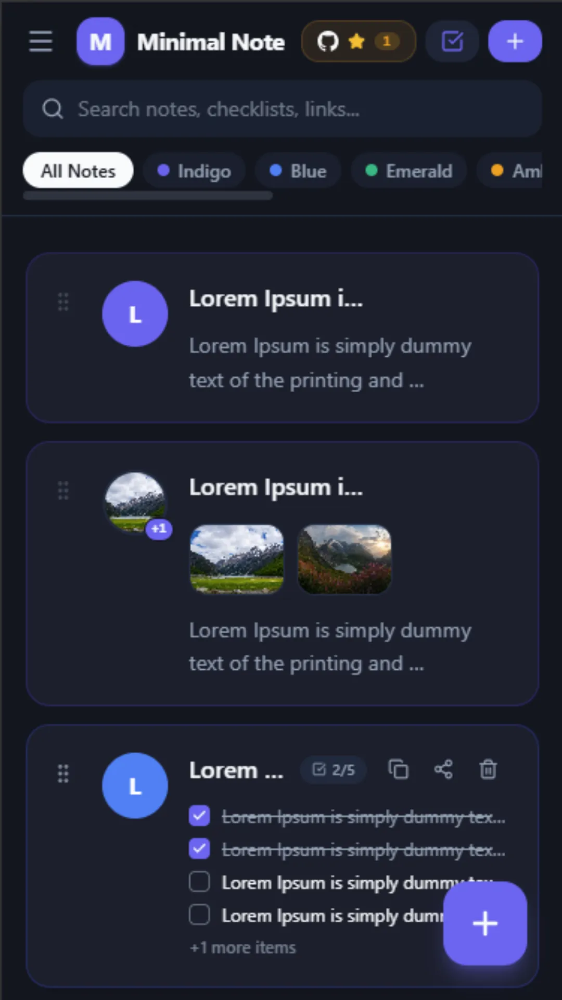

<div align="center">

  

  # Minimal Note

  **Distraction-free, 100% offline personal notes & checklist PWA with zero cloud storage, in-browser OCR, rich text editing, smart reminders, and 17 global languages.**

  <p align="center">
    <a href="https://note.yink.in/"><strong>🚀 Open Live Web App</strong></a> •
    <a href="https://github.com/glofora/minimal-note/stargazers"><strong>⭐ Star on GitHub</strong></a> •
    <a href="https://github.com/glofora/minimal-note/issues"><strong>🐛 Report Issue</strong></a>
  </p>

  <p align="center">
    <a href="https://note.yink.in/"></a>
    <a href="https://note.yink.in/"></a>
    <a href="https://note.yink.in/"></a>
    <a href="https://github.com/glofora/minimal-note"></a>
    <a href="https://note.yink.in/"></a>
    <a href="LICENSE"></a>
  </p>

</div>

---

> [!IMPORTANT]
> ### 🔒 100% Offline & Private: Your Data Never Leaves Your Device
> **Minimal Note does NOT save your data to the cloud.**
> - **Zero Cloud Servers:** There is no backend database, no remote server sync, and no third-party cloud storage.
> - **Zero Tracking or Telemetry:** No user analytics, no trackers, and no account registration or login required.
> - **Local On-Device Storage:** 100% of your notes, checklists, attached images, and preferences are stored exclusively on your device inside your browser's private **IndexedDB** database (powered by `Dexie.js`).
> - **Client-Side In-Browser OCR:** Optical character recognition runs strictly inside your browser via WebAssembly (`tesseract.js`) — images are never uploaded to any remote API.
> - **Full Data Ownership:** Export your entire notebook anytime to a standard JSON backup file or restore it with one click.

---

> [!TIP]
> ### 📲 Instant App on Any Device — No App Store Needed!
> **Minimal Note runs natively across iOS, Android, macOS, Windows, and Linux.**
> Just open **[note.yink.in](https://note.yink.in/)** in your device's browser and install the Progressive Web App (PWA) in seconds:
>
> | Platform | Browser | Fast 1-Step Installation |
> | :--- | :--- | :--- |
> | 🍏 **iOS (iPhone & iPad)** | Safari | Tap **Share** (📤) ➔ Select **"Add to Home Screen"** (⊞) |
> | 🤖 **Android** | Chrome / Samsung Internet / Edge | Tap **"Install App"** prompt on launch or browser menu (⋮) |
> | 💻 **macOS & Windows** | Chrome / Edge / Brave / Opera | Click the **Install App (⊕)** icon in the address bar or app banner |
> | 🐧 **Linux** | Chrome / Chromium / Edge | Click **"Install App"** in the top bar or browser menu |
>
> *Once installed, Minimal Note launches with a zero-latency splash screen, a full-screen standalone window without address bar, and works **100% offline** without an internet connection.*

---

## 📸 App Showcase

<div align="center">

### Desktop Workspace


<br/><br/>

| 📱 Mobile View &amp; Navigation | ✍️ Note &amp; Checklist Editor |
| :---: | :---: |
|  |  |

</div>

---

## ✨ Key Features

- **🔒 100% Offline & Zero Cloud Storage**
  - Complete privacy: no accounts, no logins, no cloud storage, and no network calls for your notes.
  - High-performance local IndexedDB storage (`Dexie.js`) persists across app restarts and browser sessions.
  - One-click encrypted JSON import and export for full local backup portability.

- **✍️ Rich Text Formatting (WYSIWYG)**
  - Seamless rich text editor with essential formatting tools: **Bold**, *Italics*, <u>Underline</u>, ~~Strikethrough~~, Bulleted Lists, Numbered Lists, Links, and Clear Formatting.
  - Keyboard shortcuts (`Ctrl/Cmd + B`, `Ctrl/Cmd + I`, `Ctrl/Cmd + U`, `Ctrl/Cmd + K`).
  - Distraction-free, borderless focus without flashing browser rings or unwanted outlines.
  - Sanitized formatted HTML rendering in note card previews and modal views without raw tags.

- **📝 Interactive Checklists with Natural Text Wrapping**
  - Instant checkbox toggle directly from both Tile and List views.
  - Multi-line text wrapping so long checklist tasks are 100% readable at a glance without horizontal truncation.
  - Automatic grouping of finished tasks into a collapsible completed section.
  - Fluid keyboard workflow: press `Enter` to create the next item, `Backspace` on an empty item to delete.

- **🎨 Dynamic Color Backgrounds & Tag Filtering**
  - 9 refined color tags plus a clean "No Tag" default option.
  - Cards dynamically adopt light and dark tinted backgrounds corresponding to their color tag.
  - Compact filter modal and bottom sheet with live note count badges per color.

- **📱 Decluttered Header & Side Navigation Drawer**
  - Unified slide-out navigation drawer on both desktop and mobile views.
  - Header stays clean and focused with Search Bar, Filter trigger, and Primary Actions.
  - Secondary utilities (Language selector, Theme toggle, Backup/Restore, App Info) neatly tucked into the side drawer.

- **📐 Unified Tile & List Views**
  - **Tile View:** Responsive multi-column masonry grid layout.
  - **List View:** Single-column full-width vertical stack rendering identical full-featured cards (with drag handle, checklists, image previews, timestamps, and quick action menus).

- **📷 Multiple Image Attachments & Canvas Compression**
  - Attach multiple photos from file upload or camera capture.
  - Client-side canvas compression downscaling (max 640px) to conserve browser memory and device storage.
  - Built-in image preview strip, individual deletion, and lightbox modal view.

- **🔍 Client-Side In-Browser OCR (Optical Character Recognition)**
  - Local text extraction powered by WebAssembly (`tesseract.js`).
  - Extract text directly from receipts, book pages, and whiteboard pictures into your note without sending data to third-party servers.

- **⏰ Smart Scheduled Reminders**
  - Set custom date & time alerts with 12-hour or 24-hour clock formats.
  - Quick presets: *In 1 hour*, *In 3 hours*, or *Tomorrow morning*.
  - Built-in snooze controls (10, 30, and 60 minutes) when reminders trigger.

- **🔔 Bottom-Center Non-Clipping Undo Toast**
  - Centered floating toast notification for note deletions with instant **Undo**.
  - Positioned cleanly above the Floating Action Button (FAB) on mobile, eliminating off-screen clipping.

- **🌐 17 Global Languages (i18n)**
  - Fully translated in: **English, Español, Français, Deutsch, Italiano, Português, Русский, Türkçe, العربية, हिन्दी, বাংলা, தமிழ், മലയാളം (Malayalam), Bahasa Indonesia, 日本語, 한국어, and 简体中文**.
  - Searchable language modal accessible from the web header and side drawer.

---

## 🛠️ Technology Stack

| Layer | Technology |
| :--- | :--- |
| **Framework & Language** | [React 19](https://react.dev/), [TypeScript](https://www.typescriptlang.org/), [Vite 6](https://vitejs.dev/) |
| **Styling & Layout** | [Tailwind CSS](https://tailwindcss.com/), Mobile-first Responsive Design |
| **State Management** | [Zustand](https://zustand-demo.pmnd.rs/) |
| **Local Database** | [Dexie.js](https://dexie.org/) (IndexedDB wrapper — 100% on-device) |
| **Rich Text & Sanitization** | `contentEditable` WYSIWYG, custom HTML sanitizer |
| **Motion & Drag-and-Drop** | [Framer Motion](https://www.framer.com/motion/), [@dnd-kit](https://dndkit.com/) |
| **In-Browser OCR** | [Tesseract.js](https://tesseract.projectnaptha.com/) (WebAssembly — client-side) |
| **Icons & Utilities** | [Lucide React](https://lucide.dev/), [date-fns](https://date-fns.org/) |
| **PWA & Offline** | Web App Manifest, Service Worker (Cache-first + Stale-while-revalidate) |

---

## 🚀 Getting Started

### Prerequisites

- [Node.js](https://nodejs.org/) (version 18 or newer)
- npm, pnpm, or yarn

### Installation & Run

1. **Clone the repository:**
   ```bash
   git clone https://github.com/glofora/minimal-note.git
   cd minimal-note
   ```

2. **Install dependencies:**
   ```bash
   npm install
   ```

3. **Start the development server:**
   ```bash
   npm run dev
   ```
   Open [http://localhost:5173](http://localhost:5173) in your browser.

4. **Build for production:**
   ```bash
   npm run build
   ```

5. **Preview the production build:**
   ```bash
   npm run preview
   ```

---

## 📂 Project Architecture

```
minimal-note/
├── public/
│   ├── screens/              # App screenshots for showcase & documentation
│   ├── favicon.svg           # Scalable modern vector favicon
│   ├── favicon-32x32.png     # Multi-resolution browser icons
│   ├── apple-touch-icon.png  # iOS Home Screen icon
│   ├── icon-192.png          # PWA standard icon
│   ├── icon-512.png          # PWA high-res icon
│   ├── icon-maskable-512.png # Android adaptive maskable icon
│   ├── manifest.json         # Progressive Web App manifest
│   └── sw.js                 # Service Worker (offline caching & reminders)
├── src/
│   ├── components/           # Modular UI components
│   │   ├── Navbar.tsx        # Top navigation with search, filter trigger & menu
│   │   ├── SideNav.tsx       # Unified slide-out drawer (mobile & desktop)
│   │   ├── NotesList.tsx     # Reorderable grid & list layout switcher
│   │   ├── NoteCard.tsx      # Note card with dynamic color background & swipe gesture
│   │   ├── NoteEditorModal.tsx # Full note creation & editing modal
│   │   ├── RichTextEditor.tsx # Clean WYSIWYG editor with borderless focus
│   │   ├── ChecklistEditor.tsx # Interactive checklist editor with keyboard workflow
│   │   ├── NoteColorModal.tsx # Dedicated color swatch & tag selector
│   │   ├── NoteReminderModal.tsx # Quick reminder presets & custom picker
│   │   ├── FilterModal.tsx   # Color tag filter modal with live note counts
│   │   ├── UndoToast.tsx     # Centered bottom notification with instant Undo
│   │   ├── ImageLightboxModal.tsx # Fullscreen image viewer
│   │   ├── LanguageModal.tsx # Searchable 16-language selector
│   │   ├── PwaInstallBanner.tsx # Native install prompt banner
│   │   ├── BackupRestoreModal.tsx # JSON data import/export (local backup)
│   │   ├── SettingsModal.tsx # Preferences (clock format, theme, language)
│   │   └── AboutModal.tsx    # App information, specs & GitHub star action
│   ├── hooks/
│   │   └── useGithubStars.ts # Live GitHub star count hook with cache
│   ├── lib/
│   │   ├── i18n.ts           # 16-language translation dictionaries & helpers
│   │   ├── pwa.ts            # PWA install prompt state & standalone detection
│   │   ├── sanitize.ts       # HTML & rich text sanitization for security
│   │   ├── storage.ts        # Dexie IndexedDB schemas & local storage operations
│   │   └── utils.ts          # Image downscaling, UUID & URL extraction
│   ├── store/
│   │   └── useNotesStore.ts  # Zustand global application state
│   ├── types/
│   │   └── note.ts           # TypeScript interfaces & domain models
│   ├── App.tsx               # Root view & modal orchestrator
│   └── main.tsx              # Application bootstrap & PWA registration
└── index.html                # HTML5 entry with instant 0ms splash screen
```

---

## 📱 Installing as a PWA

Minimal Note is a certified Progressive Web App:

- **Chrome / Edge / Brave (Desktop & Android):** Click the **"Install App"** button in the header or the automatic prompt on first launch.
- **Safari on iOS (iPhone / iPad):** Tap the **Share** button (📤) in Safari and choose **"Add to Home Screen"** (⊞).

---

## 🤝 Contributing

Contributions, feature ideas, and feedback are welcome!
1. Fork the Project
2. Create your Feature Branch (`git checkout -b feature/AmazingFeature`)
3. Commit your Changes (`git commit -m 'feat: Add some AmazingFeature'`)
4. Push to the Branch (`git push origin feature/AmazingFeature`)
5. Open a Pull Request

---

## 📄 License

Distributed under the [MIT License](LICENSE). Built with ❤️ by [Glofora](https://github.com/glofora) for focused minds.
