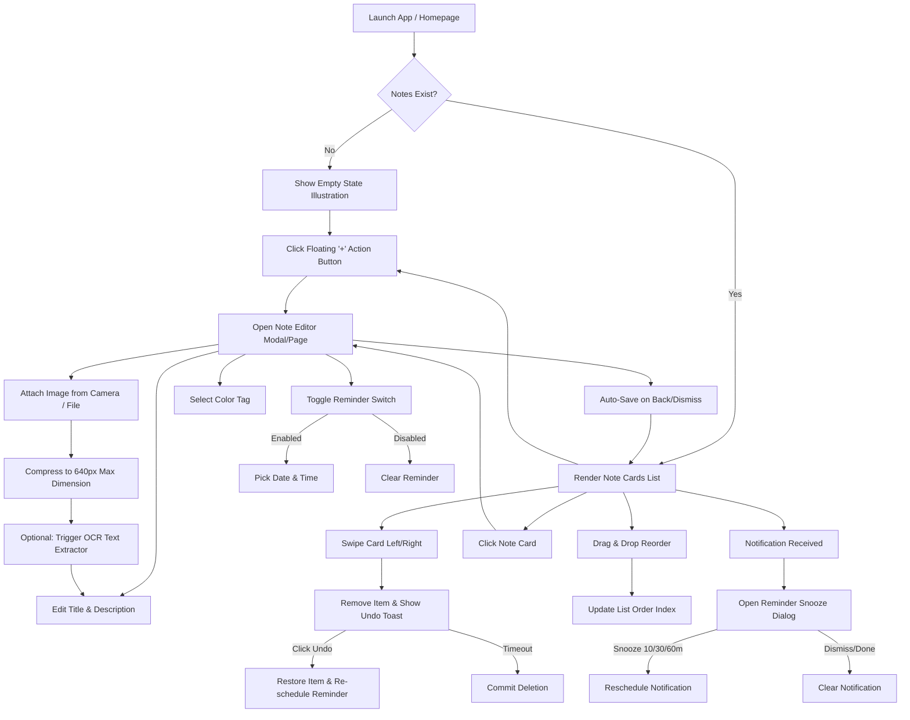

# Clean-Room Implementation Plan: Minimal Note (Modern Web & PWA)

## 1. Executive Summary & Reverse-Engineering Findings

Through static inspection and binary decompilation analysis of the reference application artifact (`minimal-note-master` / Glofora Notes, APK digest `c9c6b7aa8c7bdfed8498e4806c5e8091c51327a234b8b3da65dd6e7311e1d9aa`), the application architecture, user journeys, data flow, and functional specifications have been mapped.

### 1.1 Key Capabilities of Reference App
* **Minimalist Note & To-Do Management**: Quick capture with auto-capitalization, title, multi-line description, and distinct color tagging.
* **Image Attachment & OCR Processing**: In-memory image compression (downscaled to 640px dimension cap to optimize memory), Base64 encoding, and offline Optical Character Recognition (Google Mobile Vision OCR) to extract text directly into note content.
* **Time-Based Reminders & Alarm Notifications**: Precise scheduling of reminders with date/time pickers, 12h/24h format support, alarm manager triggers, and dedicated snooze controls (10 min, 30 min, 60 min).
* **Gestures & Interactive Interactions**: Swipe-to-delete with animated Snackbar "UNDO" action, and drag-and-drop manual list reordering.
* **Encrypted Local Persistence**: AES/CBC/PKCS5Padding encryption with PBKDF2 key derivation stored in local SQLite (`Tbl_notes`).
* **Offline Backup & Restore**: Date-stamped database backup export and restoration with validation.
* **Theme Switching**: Dark / Light mode (Night Mode) toggle with immediate UI adaptation.
* **System Integration**: Native Share Sheet integration (text + image attachment) and clipboard copy.

This plan details a **100% clean-room specification** to reconstruct an equivalent modern web application and progressive web app (PWA) using **Next.js (App Router) / React + Vite**, **Tailwind CSS**, and **shadcn/ui**.

---

## 2. Core User Flows & Interaction Models

### 2.1 User Flow Diagrams



---

## 3. Screen Breakdown & UI Component Hierarchy

Mapping original Android Activities/Fragments and Layout XMLs to React + shadcn/ui components:

| Original Android Component | Layout Resource | Equivalent Modern Web Component | shadcn/ui Primitives |
| :--- | :--- | :--- | :--- |
| `MainActivity` / `MainFragment` | `activity_main.xml`<br>`fragment_main.xml` | `MainNotesFeed` / `AppShell` | `Card`, `Button`, `ScrollArea`, `Toast`, `DropdownMenu` |
| `RecyclerView` + `note_card.xml` | `note_card.xml` | `NoteCardItem` (with swipe & drag) | `Card`, `Badge`, `Avatar`, `Tooltip` |
| `AddToDoActivity` / `AddToDoFragment` | `activity_add_to_do.xml`<br>`fragment_add_to_do.xml` | `NoteEditorModal` / `/note/[id]` | `Dialog` / `Sheet`, `Input`, `Textarea`, `Switch`, `Popover`, `Calendar` |
| `ReminderActivity` / `ReminderFragment` | `reminder_layout.xml`<br>`fragment_reminder.xml` | `ReminderModal` | `Dialog`, `Select`, `Button` |
| `SettingsActivity` / `SettingsFragment` | `activity_settings.xml`<br>`preferences_layout.xml` | `SettingsDialog` / `/settings` | `Dialog`, `Switch`, `Label`, `Separator` |
| `AboutActivity` / `AboutFragment` | `about_layout.xml`<br>`fragment_about.xml` | `AboutDialog` | `Dialog`, `Badge`, `Button` |
| Backup / Restore Dialogs | Dynamic Android Dialogs | `BackupRestoreModal` | `Dialog`, `Progress`, `Input`, `Alert` |

### 3.1 UI Component Tree

```
└── AppShell (Header, ThemeToggle, Search/Filter, OverflowMenu)
    ├── NotesFeedContainer
    │   ├── EmptyStateView (when 0 notes)
    │   └── DraggableNoteList (dnd-kit / hello-pangea/dnd)
    │       └── SwipeableNoteCard (Framer Motion drag-to-delete)
    │           ├── ColorAvatar / ImageThumbnail
    │           ├── NoteContent (Title, Description preview)
    │           ├── ReminderBadge (Formatted 12h/24h timestamp)
    │           └── ActionMenu (Edit, Share, Delete, Duplicate)
    ├── FloatingActionButton (Sticky Bottom-Right Quick Add)
    ├── NoteEditorSheet / Dialog
    │   ├── Toolbar (Close, ColorPicker, Camera/Upload, OCR Trigger, Share, Copy)
    │   ├── NoteTitleInput (Auto-capitalizing autofocus input)
    │   ├── NoteBodyTextarea (Auto-resizing multiline text editor)
    │   ├── AttachedImagePreview (Zoomable lightbox + remove button)
    │   ├── ReminderSection (Switch, DatePicker, TimePicker, Validation message)
    │   └── StatusIndicator (Auto-saved state)
    ├── ReminderAlertModal (Triggered by Service Worker / Timer)
    │   ├── ReminderDetails (Title, overdue status)
    │   ├── SnoozeSelect (10 mins, 30 mins, 60 mins)
    │   └── ActionButtons (Snooze, Complete, View Note)
    ├── BackupRestoreDialog (Export encrypted JSON, Import & Validate backup)
    └── SettingsSheet (Dark mode toggle, 24-hour time format, clear database)
```

---

## 4. Data Models & Type Specifications

### 4.1 Core TypeScript Interfaces

```typescript
export interface NoteItem {
  id: string; // UUID v4
  title: string;
  description: string;
  hasReminder: boolean;
  reminderDate: string | null; // ISO 8601 string
  color: string; // Hex color code (e.g. #3F51B5, #E91E63)
  image: string | null; // Base64 data URL or IndexedDB Blob reference
  createdAt: string; // ISO 8601 string
  updatedAt: string; // ISO 8601 string
  orderIndex: number; // Integer for manual reorder sorting
}

export interface AppPreferences {
  theme: 'light' | 'dark' | 'system';
  timeFormat24Hour: boolean;
  defaultColor: string;
  autoSaveDelayMs: number;
}

export interface BackupPayload {
  version: 1;
  exportedAt: string;
  checksum: string;
  notes: NoteItem[];
}
```

---

## 5. Storage, Cryptography & Platform Interop

### 5.1 Client-Side Encrypted Persistence Architecture
The original Android app encrypted serialized JSON using `AES/CBC/PKCS5Padding` with a PBKDF2-derived key and stored it in SQLite.

In our modern clean-room implementation:
1. **Primary Store**: **IndexedDB** using `Dexie.js` or native `idb` for high-capacity offline storage (supporting note metadata and large image blobs without hitting `localStorage` 5MB quota).
2. **Encryption at Rest (Optional / Privacy Mode)**:
   - Modern Web Crypto API: `AES-GCM-256` with `PBKDF2-HMAC-SHA256` (100,000 iterations).
   - Generates random 96-bit IV per encryption operation.
3. **Offline Backup & Export**:
   - Single-click export to `.minnote.json` or encrypted backup file.
   - Import parser validates schema integrity, sanitizes fields, and updates UI state.

### 5.2 Image Pipeline & Web OCR Engine
1. **Camera & File Capture**:
   - Standard HTML5 `<input type="file" accept="image/*" capture="environment">`.
   - Native Drag-and-drop file dropzone.
2. **In-Browser Image Resizing**:
   - Canvas-based scaling maintaining aspect ratio with maximum boundary constraint of `640px` (preserving original app's memory & storage optimization).
   - Exported as WebP / JPEG format with 0.85 quality.
3. **Optical Character Recognition (OCR)**:
   - **Tesseract.js** running in a background Web Worker (no server dependency, works completely offline).
   - Triggerable via the note editor toolbar button when an image is present.
   - Text extracted is appended to the `description` field with immediate feedback toast.

### 5.3 Reminders, Alarms & Push Notifications
1. **In-Tab Alarms**: Web Audio API chime + visual modal when tab is active.
2. **Background / System Notifications**:
   - HTML5 Notifications API (`Notification.requestPermission()`).
   - Service Worker registered with periodic timestamp checks or Alarm API (`self.registration.showNotification`).
   - Action buttons in notification: "Snooze 10m", "View", "Dismiss".
3. **System Sharing & Clipboard**:
   - Web Share API (`navigator.share({ title, text, files })`) with fallback to clipboard copy (`navigator.clipboard.writeText`).

---

## 6. Target Technology Stack

* **Framework**: Next.js 15 (App Router) with React 19 (or Vite SPA for pure static distribution)
* **Styling**: Tailwind CSS v4 / v3 with CSS custom properties for Day/Night theming
* **Component Library**: shadcn/ui (Radix UI primitives)
* **State Management**: Zustand with persistent storage middleware
* **Local Database**: `Dexie.js` (IndexedDB wrapper)
* **Gestures & Animations**:
  * Drag and Drop: `@dnd-kit/core` + `@dnd-kit/sortable`
  * Swipe & Transitions: `framer-motion`
* **Icons**: `lucide-react`
* **Date & Time**: `date-fns` with `react-day-picker`
* **OCR**: `tesseract.js` (client-side WebAssembly worker)
* **PWA / Service Worker**: `serwist` or Next-PWA for offline support and notification handling

---

## 7. Implementation Roadmap & Milestones

### Phase 1: Project Setup & Design Foundation
- [ ] Initialize Next.js project with Tailwind CSS and TypeScript.
- [ ] Configure `components.json` for shadcn/ui.
- [ ] Set up theme provider (`next-themes`) supporting Light, Dark, and System modes.
- [ ] Configure Material Palette color tokens matching reference note colors (Red, Pink, Purple, Deep Purple, Indigo, Blue, Teal, Green, Amber, Orange, Grey).

### Phase 2: Core Data Layer & IndexedDB
- [ ] Create `db/index.ts` using Dexie.js for `notes` and `preferences` stores.
- [ ] Create Zustand store `useNotesStore` with actions:
  - `addNote`, `updateNote`, `deleteNote`, `restoreNote`, `reorderNotes`.
- [ ] Implement Web Crypto AES-GCM helper for optional vault encryption and backup generation.

### Phase 3: Main Screen & Card Feed
- [ ] Build `AppShell` with navigation, theme toggle, and search bar.
- [ ] Implement `NoteCardItem` with:
  - Material avatar with capitalized first initial / image thumbnail.
  - Title and multi-line clamped description.
  - Reminder badge with humanized date format.
- [ ] Add `@dnd-kit` sortable list container for manual reordering.
- [ ] Implement Framer Motion horizontal drag gesture for swipe-to-delete.
- [ ] Integrate Sonner / shadcn toast with working "Undo" callback.

### Phase 4: Note Editor Sheet / Dialog
- [ ] Build responsive editor (Dialog on desktop, full-screen Drawer/Sheet on mobile).
- [ ] Title input with automatic sentence capitalization.
- [ ] Auto-expanding textarea for body text.
- [ ] Color selector chips with active selection indicator.
- [ ] Image attachment handler:
  - File picker + drag-drop.
  - Offscreen canvas resizer to `max 640px`.
  - Preview card with pinch/click-to-zoom modal.
- [ ] Tesseract.js worker integration for one-tap OCR text extraction.
- [ ] Auto-save mechanism triggered on form change with debounced save & unmount flush.

### Phase 5: Reminder & Notification Engine
- [ ] Build `ReminderPicker` component combining date calendar and time selector.
- [ ] Validation logic warning against past timestamps.
- [ ] Service worker notification scheduler with background alarm synchronization.
- [ ] Reminder prompt dialog featuring 10 min, 30 min, and 60 min snooze buttons.

### Phase 6: Interoperability (Backup, Share & Clipboard)
- [ ] Backup generator creating downloadable `.json` file with timestamped name (`minimal_note_backup_YYYY-MM-DD.json`).
- [ ] Import modal with file dropzone, JSON validation, and conflict resolution (merge vs overwrite).
- [ ] Note sharing utilizing native Web Share API with text and blob image, falling back to clipboard copy.

### Phase 7: PWA Support & Verification
- [ ] Web App Manifest (`manifest.json`) and service worker configuration for offline readiness.
- [ ] Verification across desktop browsers and mobile viewports.
- [ ] Audit against clean-room principles (no leaked decompiled artifacts or external proprietary dependencies).
